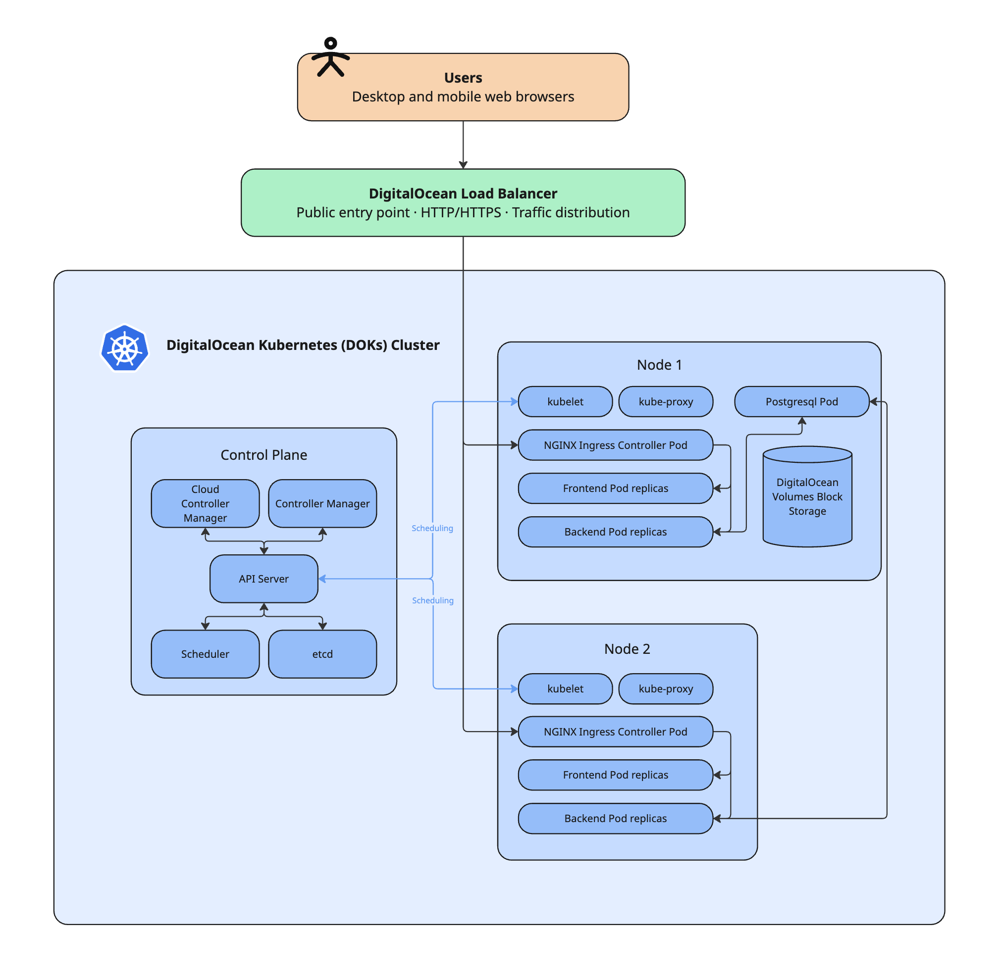
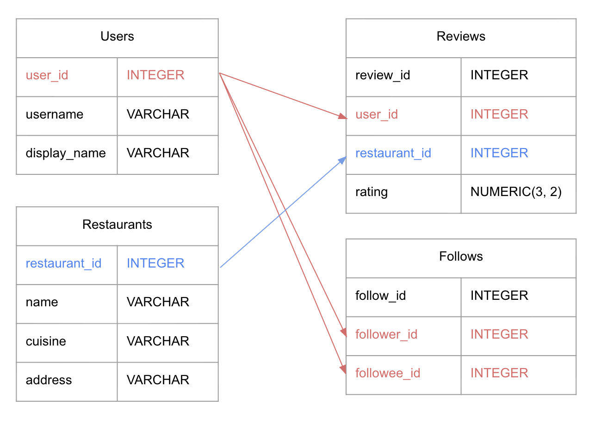

# ECE1779_Final_Project

# Motivation

### The Problem

Discovering and keeping track of restaurants can be overwhelming, especially in Toronto where there is seemingly a different restaurant around every corner. While existing platforms have taken their own approaches to addressing this issue, they leave a gap for a socially-driven and personalized experience. 

For example, [Google Maps](https://support.google.com/maps/answer/4610185/?co=GENIE.Platform=Desktop&utm) provides extensive information about restaurants including ratings, reviews, photos, etc., but its approach to restaurant discovery primarily uses a location-based search and doesn’t take into account personal taste or shared interest with a user’s social circle. Another example is [Beli](https://beliapp.com/), which uses a much more personalized experience through user rankings and social recommendations but it uses an ELO-style ranking to compare restaurants even if they are from different cuisines and price ranges. 

Given the current climate of the restaurant discovery problem, the team believes there is an opportunity to develop a service that addresses this through a social-first lens, allowing people to engage with the rest of their community while finding where to eat next. 

### Intended Users

Our primary target users are Toronto residents who enjoy exploring new restaurants, sharing dining experiences, and discovering places through recommendations from people with similar interests.

### Significance

Eating is inherently a social activity. From sitting down with your family at dinner to going to a restaurant to celebrate a milestone, the act of eating good food encompasses a large part of our social experiences. However, opportunities to share these experiences and discover new places together are increasingly mediated by fragmented online platforms. 

We believe restaurant discovery can be more engaging when it is treated as a social experience rather than simply a search for the highest-rated establishment. By making it easier to document dining experiences, share opinions with friends, and discover restaurants through community recommendations, our platform aims to extend the social aspect of dining beyond the restaurant itself.

Additionally, a community-driven discovery platform can help increase visibility for local Toronto restaurants and help users make more informed dining decisions.
# Objectives and core functionality
The main objective is to design, develop, and deploy a cloud-hosted food discovery and rating website. The initial application will support:
 User registration, login, and basic profile management.
 Restaurant listings and detail pages.
 Search or filtering by attributes such as restaurant name, cuisine, or location.
 User-submitted ratings and written reviews.
 Display of restaurant rating summaries and community feedback.
The project will also demonstrate containerization, persistent storage, cloud deployment, orchestration, automated delivery, scaling, and monitoring.

# Proposed Architecture and Technologies
The frontend will be developed with React and served in production by Nginx. The backend will use Node.js and Express to expose REST API endpoints, validate requests, apply application logic, and communicate with the database. PostgreSQL will store users, restaurants, ratings, and reviews. A relational database is appropriate because these entities have structured relationships; using one database also avoids the extra overhead of maintaining multiple database technologies.

The frontend and backend will be packaged as separate Docker images. Docker Compose will run the frontend, backend, and PostgreSQL together during local development. A named volume will preserve local database data when containers are stopped or recreated. Compose is intended for local development and integration testing, not production orchestration.

For cloud deployment, the team plans to use DigitalOcean Kubernetes (DOKS). The React/Nginx frontend and Express API will run as separate Kubernetes Deployments, exposed through Kubernetes Services. An Ingress resource and controller, with a DigitalOcean Load Balancer, will route public traffic to the appropriate service—for example, / to the frontend and /api to the backend. Separate deployments allow the frontend and backend to be updated and scaled independently.

The preferred production database is DigitalOcean Managed PostgreSQL. Keeping the database outside application pods means that replacing or scaling a pod does not replace the persistent data. Managed hosting also reduces the team's responsibility for database maintenance and backups. The team will check the service cost before provisioning it. If it exceeds the project budget, a PostgreSQL container with a persistent volume is an alternative, but the team would then need to manage backups, storage, and recovery.

DigitalOcean Container Registry (DOCR) will store versioned Docker images. Kubernetes will retrieve these images during deployment. Database credentials and API keys will be stored in Kubernetes Secrets or appropriate repository secrets, not committed to source control.

# Course technologies, monitoring, and observability
Docker and Docker Compose: Separate Dockerfiles will package the frontend and backend. Compose will define the local services, networking, environment configuration, and persistent database volume.

PostgreSQL and persistent storage: PostgreSQL will hold application records. Production data will use managed persistent database storage and an appropriate backup configuration.

DigitalOcean and Kubernetes: DOKS will run the application workloads. Deployments, Pods, Services, Ingress, ConfigMaps, and Secrets will manage execution, networking, and configuration. Kubernetes is selected over Docker Swarm because DOKS provides a managed Kubernetes environment and supports the project's orchestration and scaling goals. Kubernetes has a steeper learning curve, so the team will keep the architecture small.

Monitoring and observability: The team will inspect pod status, restarts, CPU and memory usage, and resource consumption using Kubernetes tools and DigitalOcean monitoring/metrics where available. Container logs will be reviewed through kubectl logs. Readiness and liveness probes will help determine whether containers are ready to receive traffic or need restarting. 
# Advanced features we plan to Integrate 
CI/CD using GitHub Actions. A workflow will run on agreed pushes and pull requests. It will run available tests and build checks, build frontend and backend Docker images, tag them with a version or commit identifier, and push them to DOCR. After checks pass, the workflow will update the Kubernetes Deployments and verify rollout status. This makes deployment repeatable and reduces manual steps. Credentials will be stored as GitHub Actions secrets.

Firebase Authentication will be integrated to provide secure user registration and login. Users will be able to create accounts and sign in before accessing protected features such as submitting restaurant ratings and reviews. The React frontend will use the Firebase Authentication SDK, while the Node.js/Express backend will verify Firebase ID tokens before processing authenticated requests. This avoids the need to manage user passwords directly within the application.

External Service API Integration, the application will integrate an external service API, such as Google Places API, to retrieve restaurant-related information, including addresses, locations and place details. This will enrich the restaurant discovery experience by combining external restaurant information with user-generated ratings and reviews stored in PostgreSQL. API credentials will be managed securely through environment variables or Kubernetes Secrets.

## System Diagram

## Database Schema Design

# Scope, feasibility, and risks
The minimum viable product is limited to authentication, restaurant listings and details, ratings, reviews, PostgreSQL, and a working cloud deployment. The team will prioritize a complete end-to-end user flow before optional features. This is feasible because it uses a conventional web architecture and a small number of deployable components.

Key risks include cloud costs, Kubernetes configuration, database connectivity, and integration delays. The team will check pricing before provisioning resources, agree on API contracts and environment-variable names early, use Compose for local integration, and deploy a basic version to DOKS before adding advanced features. 

# Project Plan and Team Responsibilities

## Development Plan

The team will follow an iterative development approach, with tasks divided across frontend development, backend implementation, database integration, and cloud deployment.

| Timeline | Tasks |
|---|---|
| Nov 5–7 | Finalize proposal, architecture, project scope, and responsibilities. |
| Nov 8–11 | Set up GitHub repository, Docker Compose environment, PostgreSQL schema, and API contracts. |
| Nov 12–17 | Develop frontend, backend APIs, authentication, restaurant listings, search, ratings, and reviews. |
| Nov 18–20 | Integrate frontend and backend, database functionality, and Google Places API. |
| Nov 21–24 | Deploy to DigitalOcean Kubernetes (DOKS), configure Block Storage PVCs, and implement monitoring. |
| Nov 25–Dec 4 | Complete CI/CD, test advanced features, resolve issues, and prepare documentation and presentation materials. |

## Team Responsibilities

The proposed division of responsibilities is:

| Team Member | Responsibilities |
|---|---|
| Jeslyn | Architecture Design, Motivation, Docker, Kubernetes deployment, DigitalOcean infrastructure, persistent storage, and monitoring. |
| Joshi | Architecture Design, Node.js/Express backend, REST APIs, application logic, and database integration. |
| Wasilat | Architecture Design, User requirements, frontend development, and UI design. |
| Sree | Project planning and coordination, initial restaurant data and external API exploration, AI-assisted research, and integration/documentation support. |

Responsibilities may overlap as needed during integration and testing.

## Collaboration and Risk Management

The team will use GitHub for version control, with separate branches and pull requests to track contributions and review changes. API contracts, database schemas, and environment configurations will be agreed upon early to reduce integration issues.

Key risks include cloud infrastructure costs, Kubernetes configuration complexity, Google Places API quotas, and integration delays. These will be addressed through early testing, cost monitoring, and incremental deployment.

# Initial Team Reasoning and AI-Assisted Exploration

## Initial Reasoning

The team identified an opportunity to build a social restaurant discovery platform focused on Toronto. The initial concept combined restaurant search and ratings with community-driven recommendations.

Early discussions considered:
- Building a web application rather than a mobile application to keep development manageable.
- Using PostgreSQL to manage users, restaurants, reviews, follows, and collections.
- Using Docker and cloud infrastructure to support deployment and scalability.
- Collecting information for approximately 200–300 Toronto restaurants through external data sources.
- Comparing DigitalOcean and Fly.io, and evaluating Docker Swarm versus Kubernetes.
- Determining how to implement persistent storage and select suitable advanced features.
